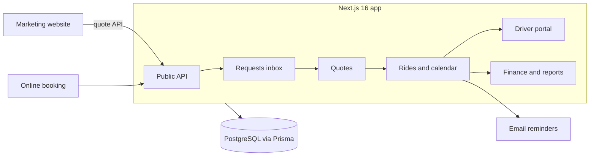

# Private Chauffeur Booking Platform: Case Study

> An operations and booking platform for a private chauffeur company in Paris that runs airport transfers, city tours and trips across Europe.
> **Source code is private.** This repository documents the project; a live walkthrough is available on request.

## The problem

The business ran on WhatsApp, spreadsheets and memory. Quote requests, confirmed rides, driver schedules and payments lived in different places, so the owner rebuilt the day by hand every morning and had no reliable view of revenue or of which driver was where.

## What I built

- **Requests and quotes**: every inquiry (website, WhatsApp, online booking) lands in one inbox with a list and a kanban view; a quote is priced from the route table and converted into a ride in one click.
- **Rides and calendar**: day, week and month views, driver assignment with schedule conflict warnings, and payment confirmation that writes the matching ledger entry.
- **Pricing engine**: fixed routes, hourly service, per vehicle factor and extras; changing a vehicle factor reprices every route and package of that vehicle in a single transaction.
- **Finance**: cash and accrual views, expenses, charts and CSV export.
- **Reports**: seven blocks with a period filter, CSV and a print ready PDF page.
- **Driver portal**: mobile first agenda, ride detail with a map (Leaflet and OpenStreetMap), one tap Google Maps, Waze, WhatsApp and call, start and finish the ride, canned messages, a full screen name sign for airport pickups and a PDF receipt.
- **Online booking**: route, vehicle, extras, passenger details and a simulated payment step, then a PDF voucher and email reminders (24 hours before and "driver on the way").
- **Roles and a demo login**: admin, operator, driver and a demo role for the owner, with per area write permissions and personal data hidden where the role should not see it.
- **Kept out of search engines** on purpose: noindex and nofollow on every route.

## Architecture

- **Server Actions with a two layer guard**: a proxy checks every action id against the build manifest per role, and each action checks the session again, so a demo user cannot reach a write action by calling it directly.
- **Security hardening after a pentest**: rate limiting on login and the public API, strict security headers (CSP, HSTS, frame denial), CSV formula neutralization and an idempotency key on bookings.
- **Prices stay on the server**: the public quote API computes the price; the browser never sends one.
- **Ships as a container**: a multi stage Docker image running as a non root user, with Postgres on an internal network only.

## Scale

- ~27k lines of TypeScript
- 25 database tables, 22 screens
- 62 test files (46 unit and integration, 16 end to end), ~7.9k lines of tests

## Quality

Before the first release the system went through a functional QA pass across five roles, a performance pass with a year of generated data and a security pentest. All 29 findings were fixed or formally accepted, then retested. Mobile Lighthouse on the booking page went from 75 to 89, and the finance screen from 3.9 s to under 20 ms.

## My role

Product discovery with the owner, data model, full stack development, security review and deployment. I planned the work in phases and coordinated AI coding agents in parallel, reviewing each delivery before it was merged.

Status: in development (payment gateway pending).

---
Built by **Victor Sestrem** · [LinkedIn](https://www.linkedin.com/in/victor-sestrem/) · victor-sestrem@hotmail.com
