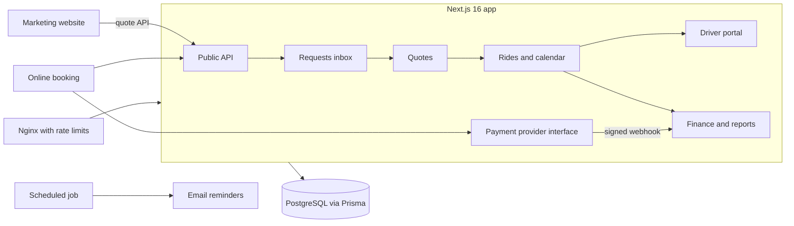

# Private Chauffeur Booking Platform: Case Study

> An operations and online booking platform for a private chauffeur company that runs airport transfers, city tours and trips across Europe from Paris.
> **Source code is private.** This repository documents the project; a live walkthrough is available on request.

## The problem

The company serves travelers arriving in Paris and London with airport pickups, private tours and long distance trips (Versailles, Disneyland, Champagne, Switzerland, Italy and more). The business ran on WhatsApp, spreadsheets and memory: quote requests, confirmed rides, driver schedules and payments lived in different places, so the owner rebuilt the day by hand every morning and had no reliable view of revenue or of which driver was where.

## The solution

One web platform with three faces: an operations dashboard for the owner and the office, a mobile first portal for drivers, and an online booking page where travelers price and book a ride on their own. Every request, from any channel, ends up in the same pipeline: request, quote, ride, payment, ledger.

## What I built

- **Requests and quotes**: every inquiry (website, WhatsApp, online booking) lands in one inbox with a list and a kanban view; a quote is priced from the route table and converted into a ride in one click.
- **Rides and calendar**: day, week and month views, driver assignment with schedule conflict warnings, and payment confirmation that writes the matching ledger entry.
- **Pricing engine**: fixed routes, hourly service, per vehicle factor and extras; changing a vehicle factor reprices every route and package of that vehicle in a single transaction.
- **Finance**: cash and accrual views, expenses, charts and CSV export.
- **Reports**: seven blocks with a period filter, CSV and a print ready PDF page.
- **Driver portal** (mobile first web app, no native app): agenda, ride detail with a map (Leaflet and OpenStreetMap), one tap Google Maps, Waze, WhatsApp and call, start and finish the ride, canned messages, a full screen name sign for airport pickups and a PDF receipt.
- **Online booking**: route, vehicle, extras, passenger details and a payment step, then a PDF voucher.
- **Payments**: a single provider interface with full or deposit charging and a signed webhook that marks the booking as paid and posts it to the ledger. Today it runs on a simulated provider; Stripe or Pagar.me plugs in as one new file.
- **Email notifications**: booking confirmation and reminders (24 hours before and "driver on the way") over SMTP, sent by a scheduled job every 15 minutes.
- **Roles and a demo mode**: admin, operator, driver and a demo role for the owner, with per area write permissions and personal data hidden where the role should not see it. In demo mode a landing page offers three one click entries (dashboard, driver portal, booking), payments are simulated and no email leaves the server.
- **Kept out of search engines** on purpose: noindex and nofollow on every route.

## Architecture

- **Server Actions with a two layer guard**: a proxy checks every action id against the build manifest per role, and each action checks the session again, so a demo user cannot reach a write action by calling it directly.
- **Sessions that can be revoked**: each user carries a session version, so signing out, a password change or deactivation ends every open session at once.
- **Prices stay on the server**: the public quote API computes the price; the browser never sends one.
- **Ships as a container**: a multi stage Docker image running as a non root user, with Postgres on an internal network only, behind Nginx with per IP rate limits on login, the public API and every Server Action.

## Scale

- ~29k lines of TypeScript, plus ~9.3k lines of tests
- 25 database tables, 24 screens
- 71 test files (54 unit and integration, 17 end to end)

## Quality

Before the first release the system went through a functional QA pass across five roles, a security pentest, a full static security scan and a load test. Every finding was fixed or formally accepted, then retested:

- 29 QA and pentest findings: 26 fixed, 3 accepted.
- 12 static scan findings (none critical or high): all fixed.
- Load test on a local copy seeded with a year of generated data: 8,736 requests, zero errors.
- Mobile Lighthouse on the booking page went from 75 to 89, and the finance screen from 3.9 s to under 20 ms.

## Status

Demo: deployed on a staging server for the owner's review, with sample data. The payment gateway is pending the owner's choice.

## AI in the development process

The product itself does not use AI; the way it was built does.

- **AI coding agents in parallel**: I split each phase into independent work streams and ran AI coding agents on them at the same time, each in its own branch, while I acted as the coordinator who planned, reviewed and merged.
- **An AI audit loop**: a second AI tool, working read only, audited the finished code in rounds; the fixes went back to the coding agents and the audit ran again until no serious finding was left (four rounds, zero high severity findings at the end).
- **An AI security scan**: a full static security review of the codebase, with every confirmed finding fixed and retested.

## My role

Product discovery with the owner, data model, full stack development, security review and deployment. I planned the work in phases, coordinated the AI coding agents and reviewed each delivery before it was merged.

---
Built by **Victor Sestrem** · [LinkedIn](https://www.linkedin.com/in/victor-sestrem/) · victor-sestrem@hotmail.com
